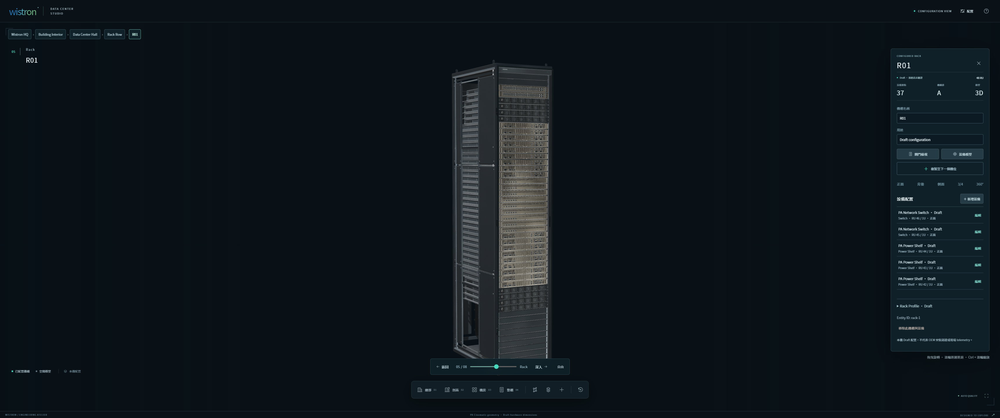

# Wistron Data Center Digital Twin V2

現有 Three.js 工作台上的 PA Cinematic Rack、資料驅動設備配置與八層導覽，現已擴充 Phase 3／4：HQ 日間 Draft 場景、多 Row 機房、唯讀 Digital Twin 與可操作 Mock 告警定位。HQ 原始照片尚未取得，精確外觀未驗收；機房配置／OEM 尺寸為 Draft，真實 PA API 整合 Pending。所有展示 telemetry 明示 DEMO／MOCK。

## 交付與證據

- [Phase 3／4 功能矩陣、修復與限制](docs/phase3-4/README.md)
- [本輪實測、完整 Regression 與效能](docs/phase3-4/TEST-RESULTS.md)
- [HQ 修色前後、PA 比對、機房、Mock 與操作影片](docs/phase3-4/VISUAL-COMPARISON.html)
- [唯讀 API Contract](docs/phase3-4/API-CONTRACT.md)／[安全與資料隔離](docs/phase3-4/SECURITY-REVIEW.md)
- [完整交付報告、P1 / P2 修復矩陣與限制](docs/phase1-2/README.md)
- [測試結果與重現方式](docs/phase1-2/TEST-RESULTS.md)
- [PA 原始畫面並排比較](docs/phase1-2/VISUAL-COMPARISON.html)
- [實際 Cinematic 播放錄影](docs/phase1-2/evidence/cinematic-playback-1720x720.webm)
- [實作架構與座標契約](docs/phase1-2/ARCHITECTURE.md)

## 執行

使用 Node.js 20 以上版本（本次測試為 24.22.1），不需要前端建置或執行期套件：

~~~sh
node server.mjs
~~~

開啟 http://127.0.0.1:4300 。PORT 可調整連接埠；HOST 預設為 loopback。需透過 HTTP / HTTPS 與 WebGL 2 瀏覽器使用。若要由同一伺服器檢視證據畫廊，以 TEST_MODE=1 啟動，再開啟 /docs/phase3-4/VISUAL-COMPARISON.html；一般模式不公開測試與文件路徑。

## 操作

| 操作 | 行為 |
|---|---|
| 滾輪／前後按鈕／上下方向鍵 | 導覽模式逐層進入或返回 |
| 拖曳、右鍵拖曳 | 旋轉、平移；保留導覽進度 |
| 自由探索、Ctrl + 滾輪、雙指 | 縮放／探索；不改變語意層級 |
| Breadcrumb | 返回指定父層 |
| Rack 內點選設備 | 進入設備層；有資產時可到 Board／Component |
| 設備清單的編輯／新增 | System、Switch、Power Shelf 配置、移位、尺寸及識別資料 |
| Front／Rear／Side／3/4／360° | Rack 多角度與旋轉展示 |
| Cinematic | 原始時間軸播放／暫停／seek／返回安裝狀態 |
| Home／Esc | 重置目前層級視角／關閉操作面板或停止電影 |
| 配置 | JSON 匯入、匯出；變更通過驗證後自動本機儲存 |
| 場地 | HQ 四角度、Hall／Row 選取、多 Row 與 Rack 座標配置 |
| 監測 | DEMO／MOCK 十步示範、告警／設備清單、來源／時間／歷史、點選定位 Node |

八層路徑：HQ → Building Interior → Hall → Row → Rack → System → Tray / Board → Component。缺少內部模型的設備會明確停止深入，不生成假零件。

## 測試

~~~sh
npm ci
npx playwright install chromium ffmpeg
npm test
~~~

安裝 Chrome 的機器也可設定 BROWSER_CHANNEL=chrome。PLAYWRIGHT_MODULE 可指定外部 Playwright module，V3_EVIDENCE_DIR 可指定本輪全部輸出位置（含 regression 子目錄）。`npm test` 包含 P1／P2 與 P3／P4；`npm run test:phase1-2` 可單獨重跑前版。測試自動啟動獨立 loopback server，不需要先執行 dev server。環境與本輪實際使用的套件版本見測試報告。

## 結構與授權

app.js 保留 Three.js renderer、OrbitControls 與 PA 室內光照，建築／機房拆入 modules/environment。modules/domain 管配置及驗證；modules/scene 管 PA geometry、shader、GLB、LOD 與狀態提示；modules/navigation 管穩定路徑及相機；modules/twin 管唯讀來源、identity、telemetry／health；modules/ui 管配置與監測。示範 inventory 位於 data/demo-config.json，公開監測模式位於 data/monitoring.json，不能放任何憑證。

Three.js 為 MIT，Noto Sans TC 為 SIL Open Font License。PA 整合依使用者對其專案的明確授權，固定來源與 SHA-256 見 assets/pa/provenance.json；沒有將 PA 程式、GLB 或品牌另行宣告為 MIT。HDR 原始來源為 Poly Haven CC0，處理資訊見 assets/pa/README.md。不得把 Draft 外形換算值當成 OEM 硬體規格。

本輪外部 PBR 為 Poly Haven CC0，來源與 SHA-256 位於 assets/environment/provenance.json；官方建築歷史照片僅外連參考，未轉載進 Repository。
