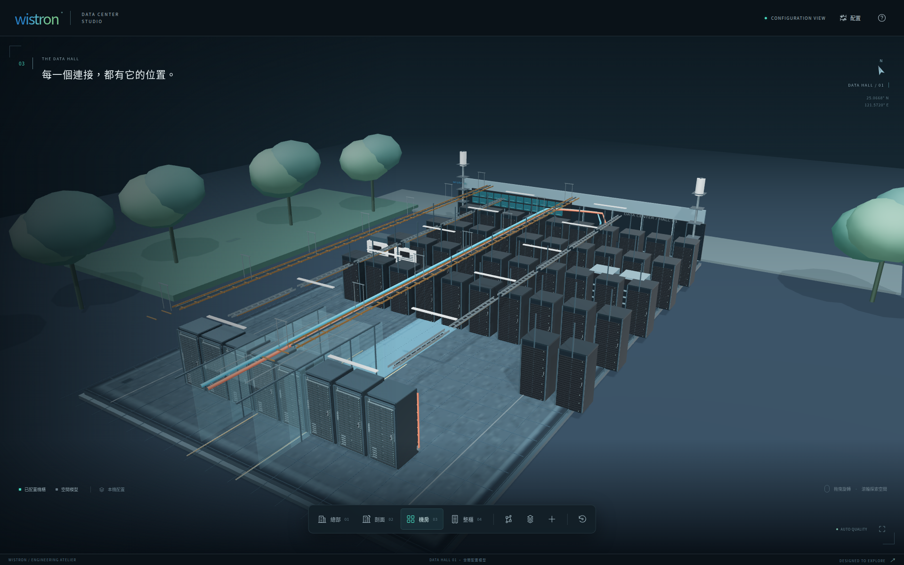

# Wistron Data Center Studio

以 Three.js 打造的互動式 3D 資料中心原型。從總部概念建築、建築剖面、大型機房，到整排可配置機櫃與精細設備模型，提供連續的空間探索體驗。



## 功能

- 總部外觀、剖面、機房、機櫃排四種空間尺度
- 拖曳環繞、平移、縮放與分階段導覽
- 點選機櫃、開門、隔離、前後視角與整排拆層
- 新增、複製、重新命名與設定機櫃用途（1–10 櫃）
- 液冷、供電、網路概念流路疊圖
- 本機 JSON 配置匯入／匯出
- 使用者提供的運算板與液冷組件 GLB 模型檢視
- 本地 Three.js、字型與模型資產；執行時不需外部 CDN

這是**配置與空間視覺原型**，不是即時監控系統。總部與機房為概念模型；流路不是 CFD 模擬，也不連接或控制任何現場設備。配置僅儲存在瀏覽器本機。

## 執行

需要 Node.js 18 以上版本，不需要建置步驟或安裝執行期套件。

```bash
npm start
```

開啟 <http://localhost:4300>。若需使用其他連接埠：

```bash
PORT=8080 npm start
```

請透過 HTTP 開啟，勿直接以 `file://` 開啟 HTML；瀏覽器需要支援 WebGL 2。

## 鍵鼠操作

| 操作 | 功能 |
| --- | --- |
| 左鍵拖曳 | 環繞模型 |
| 右鍵拖曳 | 平移 |
| 滾輪 | 縮放；導覽時切換空間階段 |
| 點選機櫃或標籤 | 聚焦並開啟配置面板 |
| `Home` | 回到機房總覽 |
| `Esc` | 關閉設備、流路或機櫃面板 |

## 測試

```bash
npm install
npm run dev
npm test
```

測試會自動啟動獨立伺服器、下載配置的 Playwright Chromium（若尚未存在），並檢查主要空間、機櫃選取、GLB 載入、配置操作及手機版配置對話框。

## 專案結構

- `index.html`：繁體中文工作台介面
- `styles.css`：視覺與響應式樣式
- `app.js`：Three.js 場景、模型與互動
- `server.mjs`：無外部依賴的靜態網站伺服器
- `assets/`：GLB 設備模型與繁中字型
- `vendor/`：Three.js 與 addons，授權見 `vendor/THREE-LICENSE.txt`
- `tests/smoke.mjs`：Playwright 真實瀏覽器測試
- `previews/`：主要場景截圖

## 資產與商標

Three.js 使用 MIT 授權；Noto Sans TC 使用 SIL Open Font License，詳見同目錄授權檔。`assets/` 中的 GLB 為使用者提供並授權本專案使用的模型；商標與該等模型不另外以開源授權釋出。

本專案生成與整理過程由 AI agent（OpenHands）協助完成。
