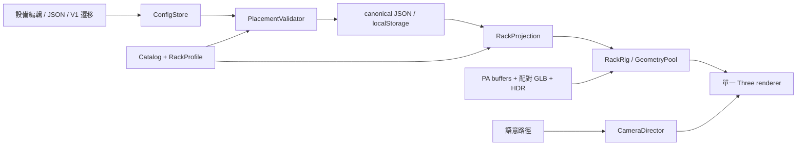

# 實作契約

## 配置與投影

`modules/domain/configuration.js` 不依賴 DOM 或 Three。配置 schemaVersion=2、units=mm，Catalog 存型號／視覺 binding／來源／子部件定義；EquipmentInstance 存 stable id、deviceId、name、modelId、rackId、dimensionsMm、placement、children。Row 與 Rack 也有獨立 ID。名稱、位置或 deviceId 改動不改 Entity ID。子部件 ID 不使用 Three UUID 或 array index。

同一 validator 處理所有寫入及載入。Grid 由底部起算，`start - 1 + span <= capacity`；RU／OU 不混用。設備旋轉體積採 Y 軸 OBB + XZ separating-axis test，前後面不被當成互不碰撞。物件 envelope 保留 authored origin 偏移，沒有獨立置中。所有數值須為有限正數／合法向量。

ConfigStore 先 clone → validate → persist → notify。投影先在 scene 外建好替換物件才交換，舊資源最後釋放；失敗回復原 document 與投影。Canonical JSON 排序 object keys、保留陣列順序與 revision，因此 Export → Import → Export 可逐 byte 一致。V1 不具 equipment inventory，遷移為空清單並標 `not-provided`；保留原 storage 及 `.backup`。

示範可用空間是明示的 Draft 編輯器容積。Catalog 新型號可使用現有四個 PA render variants（server、switch、nvlink、powershelf），其中 switch／nvlink 都屬 Switch；新增真正資產 renderer 時擴充資產 binding，不需要改導覽及驗證器。現階段不接受任意外部 GLB URL。

## 座標與 PA 資產

- 原始 PA Rack U=0.30 authored units。World 使用公尺；`unit = profile.pitchMm / 0.30 / 1000`。
- 一次套用原始 aspect `[0.688, 1, 0.802]`。Bare GLB、cooling GLB 與 procedural chassis 共同掛在同一個設備 mount；沒有 `4 / max(size)`。
- 尺寸縮放由配置決定。安裝旋轉在物理座標中進行，再轉回 authored aspect，避免非等向比例使旋轉設備剪切。
- `GLTFLoader.parser.associations` 對回來源 node，保留 originalNode、semantic layer、boardIndex、component 與 stable childId。不能用 Loader 正規化後的顯示名稱來綁流路。
- 配對 SHA-256 同時檢查 bare 資產與 cooling extras 版本。失敗顯示錯誤，不切換到假模型。
- 材質使用原始 fragment shader、原始 HDR log atlas 解碼、原始材質貼圖／切線／thin film 與 cooling route；Three 只接管相機、buffer、scene graph 及生命週期。
- 門框是新增 Draft 視覺機構。位移不修改 installed placement；先打開門，再抽出設備，歸位後才關門。

## 導覽與動畫

`resolveJourney()` 從配置解析八層穩定路徑。相機位置不決定目前語意層級；切換自由模式、旋轉或縮放不清除導覽。失去設備／子部件時回到最近可用層級。資產缺失時不生成零件。

CameraDirector 每個 frame 只有 `orbit`、`transition` 或 `timeline` 一個 owner。新 transition 從當前位置與 target 開始；取消回傳 false，不延後覆寫新鏡頭。開始轉場會清除 Orbit damping 的剩餘量，同時保留目前姿態。自由探索與 transition 另檢查可見 Rack 外框 envelope，防止近距離旋轉／平移進入櫃體；背面設備的攝影機朝向會隨 mount 旋轉。此邊界處理仍由 CameraDirector 執行，timeline 使用已檢查的固定 choreography。非同步資產使用 AbortController + navigation token，返回上層後不會被較晚完成的載入拉回。

滾輪在導覽模式攔截並累積閾值、限制每次切換；自由模式及 Ctrl + 滾輪交給 OrbitControls。UI 面板的滾動不轉送給 canvas。觸控可使用可見前後按鈕／Breadcrumb、拖曳及雙指縮放，沒有假稱在實體觸控裝置上測過。

Cinematic 保留 PAL10Timeline 原始 39.7 秒非線性 progress clock、10 個階段與 core 的 assembly/cooling/camera weights。Rack equipment 清單仍來自 document；helper 的原始 inventory 不直接加入 scene。開始播放加入短鏡頭銜接；可暫停、倒拉 seek、返回安裝狀態。Reduced Motion 不自動播放。

## 資源所有權

GeometryPool 依 shape／structure key 共用 GPU geometry；RackRig 持有引用與自己的 material／門體。換配置、刪除 Rack 會 release。L10Library 只有被檢視時才載入；最後一個引用離開、取消載入或失敗會 dispose geometry、material、texture 及 ImageBitmap。CPU shape cache 最多 32 個。

PAStudio 持有 environment textures、fallback textures 與 shadow target。基礎建築資源留在應用生命週期，並非每次重建 Rack 都重新生成。資源測試報告的是 Three renderer 的 geometry／texture 記帳與 owned reference counts，不等同於完整 GPU VRAM 或作業系統 memory profiler。

## Phase 4 邊界

目前沒有 management IP、憑證、telemetry polling 或 API adapter。之後 provider 對應應使用獨立 mapping：`provider + externalRack/System/NodeId → platformEntityId`；不得以 IP、顯示名稱、Three UUID 或場景陣列位置當主鍵。Telemetry、health、warning/fail/recovery 與 freshness 必須另成 store，不覆寫本輪的配置及 installed placement。
