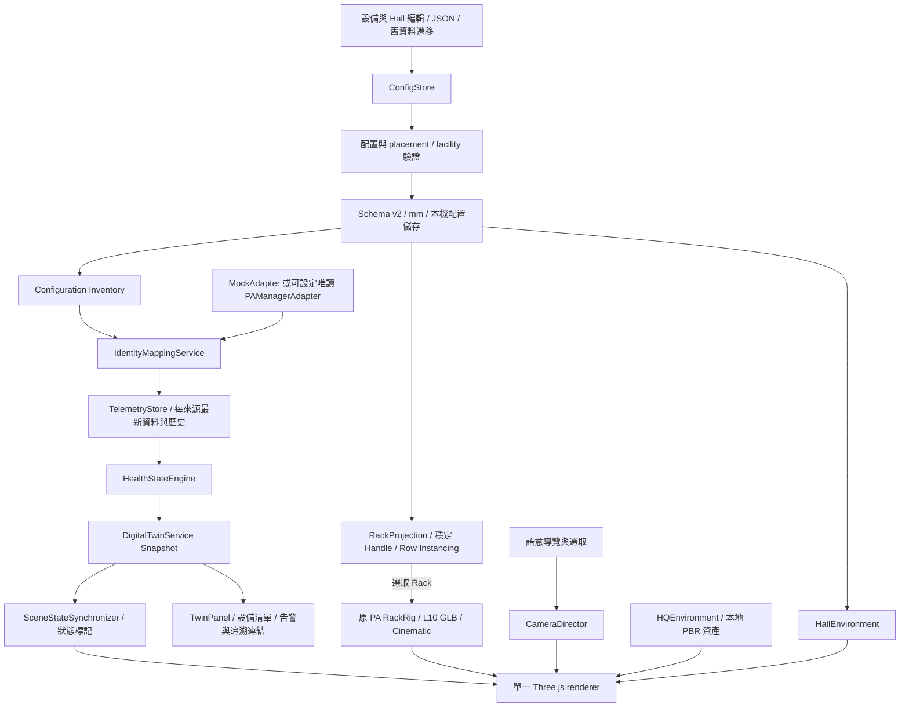

# Phase 3 / 4 架構與實作邊界

本文件描述目前 Repository 的增量實作。Phase 1 / 2 的配置、PA Cinematic Rack、原始 GLB 與八層導覽仍是基礎；本輪加入 HQ / Hall 環境、Rack LOD 與唯讀 Digital Twin。沒有重建 PA Manager，也沒有實際硬體控制介面。

建築證據與授權界限見 [HQ-REFERENCES.md](HQ-REFERENCES.md)，照片與模型審查見 [HQ-COMPARISON.md](HQ-COMPARISON.md)。**使用者先前提供的照片在本工作環境不可取得**；本輪 HQ 依官方歷史照片改善可見特徵，未確認的比例、窗數、入口、背面與屋頂仍為 Draft。機房布局是可配置的合成場景，不是緯創現場布局。真實 PA Manager API 連線仍為 Pending；目前可重現展示使用明示的 DEMO / MOCK。

## 1. 資料流與責任分界

配置與 Telemetry 是兩份不同用途的資料。配置持有型號、尺寸、安裝位置及實體階層；Telemetry 持有觀測時間、來源、狀態、測試、數值及告警歷史。`DigitalTwinService` 只讀取配置，不呼叫 ConfigStore 寫入操作。一次事件不會重建 Rack 或 Hall，也不會改變 installed placement。

`modules/twin/{contracts,identity,telemetry,health,service}.js` 不依賴 Three 或 DOM。`modules/twin/adapters.js` 負責資料取得及傳輸；`modules/scene/twin-synchronizer.js` 與 `modules/ui/twin-panel.js` 是同一份 Service Snapshot 的兩個呈現端。各端不自行推論另一份設備健康狀態。

## 2. 配置相容性、Hall 與 LOD

配置繼續使用 `schemaVersion: 2`、`units: "mm"`。新增的是可選 `facility: { halls: [...] }`；既有 `site / rows / racks / rackProfiles / catalog / equipment` 契約保留。沒有 facility 的既有文件，`normalizeFacility()` 在讀取時從 Row / Rack 計算 Draft Hall，並不偷偷把新欄位寫回文件。因此既有 canonical JSON round-trip 與舊資料遷移仍走原本的 ConfigStore。

Hall 有 stable ID、名稱、`boundsMm`、天花板高度及明確 Draft 證據，Row 以 `hallId` 參照 Hall，Rack 以 `rowId` 參照 Row。設備仍以 `rackId` 參照 Rack。可選 infrastructure 支援 power / cooling 的 Draft 外形、位置與尺寸；不宣稱現地管線或實際設備型號。

配置驗證涵蓋 Hall 邊界、Row 參照、Rack 外框及基礎設施碰撞。Rack 外框由目前固定版本 PA 幾何與 Profile 換算，不是 OEM CAD 認證。RU / OU 標準節距不代表整台 System 的外形尺寸、門體掃掠或維修淨空已獲 OEM 證實。所有編輯、JSON 匯入及布局操作沿用共同驗證與失敗回滾流程；巢狀未知欄位及敏感資料不得進入配置儲存。

`buildLayout()` 可規劃 1–16 Row、最多 128 Rack；保留的 Rack 與設備保有原 ID，新 Rack 為空配置。1 / 4 / 32 Rack 是本輪實測案例，並不代表已在所有數量、瀏覽器及 GPU 上建立效能保證。

Hall 地板、牆面、天花板、照明與 Draft 設施由配置生成。600 mm 地板模組是場景設計值；超大平面可合併呈現，避免幾何數量無上限成長。前側採剖視展示，天花板依導覽層級顯示。供電、冷卻及網路 flow 顯示是概念路徑，不能作為施工或實際拓樸資料。

`RackProjection.rigs` 為每台配置 Rack 保留穩定 Handle。`equipmentIds` 與 `record(id)` 可在不載入精細模型的情況下提供 inventory；`item(id)` 與詳細幾何 getter 則是明確的 promotion 操作，回傳真正的 PA RackRig / item。全景以每 Row 的共享幾何及 InstancedMesh 呈現外殼、格柵、立柱等近似外觀，不製造不存在的設備清單。

`isolate(rackId, { rowId, hallId })` 管理顯示範圍，並釋放非焦點 Rack 的細節。Hall / Row 概覽不應呼叫 `handle.items` 枚舉設備，否則會意外載入 PA 細節。Telemetry Synchronizer 只讀 `handle.detail`，不觸發 promotion。進入 Rack 後使用原 PA geometry、shader、光照、GLB binding 與動畫；概覽 LOD 不是 Rack 近景品質的替代品。

## 3. HQ 與室外資產

`HQEnvironment` 封裝階梯量體、石材 / 玻璃分區、窗框、入口 Draft、道路、人行道與植栽；其資料中的 evidence 狀態保留後續逐面校正能力。石材 normal / roughness 及道路貼圖使用本地已記錄來源與 SHA 的 CC0 素材。官方建築照片是研究證據，不作 runtime 貼圖或未授權素材包。

植栽使用枝幹與葉片、alpha-test 葉冠及距離 LOD，沒有用幾何球體或低面數樹冠代替。日間天空、環境反射、太陽與陰影由 HQ 模組持有。進入 Hall / Rack 時切換相應環境；原 PA Cinematic 材質與 HDR 資產保留，不被 HQ 日光材質或告警色覆寫。

這是照片特徵參考的程序化模型，並非攝影測量成果。道路尺度、樹種 / 株數 / 座標、窗數與隱藏結構尚未實測；不能把「模型具備該特徵」視為「現場精準還原 PASS」。

## 4. 八層導覽、Node 定位與相機控制

| 深度 | 語意層級 | 選取及資料來源 |
| --- | --- | --- |
| 0 | HQ | Site ID；歷史照片參考 / Draft 場景 |
| 1 | Building Interior | Site 派生的 stable interior ID；概念剖面 |
| 2 | Data Center Hall | Hall ID；facility 邊界與所屬 Rack |
| 3 | Rack Row | Row ID；Row 顯示過濾與相機範圍 |
| 4 | Rack | Rack ID；只載入焦點 Rack 的 PA 細節 |
| 5 | System / Equipment | EquipmentInstance ID；正反面與抽出座標 |
| 6 | Tray / Board | Catalog 定義與 Equipment child stable ID；實際提供的 GLB 部件 |
| 7 | Component | 已提供的部件定義與 child stable ID；缺資產時不生成假零件 |

Node 是監測 inventory 的邏輯實體，並未硬加為第九個相機層級。一台 System 可對應多個 Node。Mock 以 `${system.id}::node-0/1` 產生可重現的兩個邏輯 Node，只有已有 Board child 時才提供 `boardId`；這個對應明示為 DEMO，不是 OEM Node / Board 認證。

告警定位沿 Rack → System → 已對應的 Board 進入，`state.nodeId` 保留使用者正在查看的邏輯 Node，詳細面板顯示其來源、測試、歷史與時間。Node 無 Board 模型時定位所屬 System，並說明缺少獨立模型。沒有直接觀測資料的 Component 維持 Unknown；System 或 Node FAIL 不會讓全部零件被推測成故障。

`resolveJourney()` 負責語意路徑；縮放數值不決定導覽深度。`CameraDirector` 在 orbit、transition、timeline 間維持單一控制權。新轉場從當前姿態開始，取消回傳 false；滾輪、Breadcrumb、告警定位及動畫不得各自寫另一套相機狀態。配置改變會取消舊資產請求，重新解析仍有效的選取，缺失時回到可用層級。

L10 載入以 AbortController 與 navigation token 阻止過期結果附回場景；重複的 Cinematic 請求取消前一次載入。取得 GLB lease 後若 clone、shader binding 或掛載階段失敗，移除該次嘗試的 hierarchy、恢復外殼可見性並只釋放該次引用，不能直接 dispose 另一設備仍使用的共享資源。Cinematic 選取透過 `projection.item()` 取得真正 RackRig，不能把概覽 Handle 傳入需要 shader / GLB binding 的介面。動畫位移只改呈現姿態，不覆寫配置安裝座標。

相機邊界處理與 P1 / P2 相同，以可見 Rack envelope 避免近距離穿入櫃體。自由探索仍保留語意進度。Hall 是可檢視剖面，不是具實測牆面碰撞網格的完整建築漫遊系統。觸控模擬測試不能替代實體手機 / 平板 GPU 實測。

## 5. Identity、Telemetry 與 Health

Configuration Inventory 先產生 Site / Hall / Row / Rack / System / Board / Component 階層，Adapter 再提供 Node 及明確 bindings。`IdentityMappingService` 使用 `provider + externalKind + externalId → entityId`；不依名稱、IP、場景陣列位置或 Three Object UUID 猜測對應。未知、歧義或無父 System 的來源列入待對應資料，不套到別台設備。Node 的 Rack 歸屬以現行配置中父 System 的位置為準。

每筆事件包含 provider / mode、source、stable event ID、observedAt、health，並可帶 sequence、metrics、test、message 與已驗證的追溯連結。`receivedAt` 由服務時鐘注入。輸入先做 schema / 深度 / 大小 / 安全檢查，再映射 entity，最後送入 TelemetryStore。未來 Prometheus、Grafana、DCGM、Node Exporter、Redfish、PA Test Result、Bug Finder 均是來源契約擴充點；目前沒有宣稱已連上這些服務。

TelemetryStore 以 entity / provider / source 保存最新樣本。事件重複、較舊觀測時間或不前進的 sequence 不覆寫新狀態；超出容許時間偏差的未來事件拒收。可接受的資料深度複製並凍結，避免外部物件後續修改已接受紀錄。歷史、去重與拒收紀錄均有容量上限；拒收診斷不保留原始敏感 payload。

Health 至少有 Healthy、Warning、FAIL、Recovering、Unknown、Offline、Stale。無資料為 Unknown；超過 freshness TTL 的 Healthy 變為 Stale；連線中斷超過寬限時間顯示 Offline。FAIL / Warning / Recovering 的來源未恢復前，資料中斷不能被當作故障已解除，因此保留告警 health 並分別標示 stale / offline freshness。不同來源的 Healthy 不會消除另一來源仍有效的 FAIL。

聚合只往父層傳播：已知 Node 影響 System，再影響 Rack / Row / Hall；只有實際具觀測的 Board / Component 才參與該支路。缺少 Component Telemetry 不會把所有已知健康 Rack 一律變為 Unknown。Component 的直接 FAIL 可往上形成告警，但不推論某個未觀測 Node 已 FAIL。

`DigitalTwinService` 合併資料並對 UI / 3D 發送 Snapshot。Mock 時鐘可由 `advance(ms)` 決定，狀態轉換、延遲、亂序及 Stale 示範不依賴實際等待。重連保留同一 Adapter session 的有效歷史；切換 Mock / live、替換 Adapter 或 Mock resetRevision 改變時清空舊監測資料，避免不同來源混合。配置 reconcile 保留仍有效的監測狀態，新設備沒有新樣本便仍為 Unknown。

## 6. Adapter 與安全邊界

完整介面及資料範例見 [API-CONTRACT.md](API-CONTRACT.md)。`PAManagerAdapter` 是可設定的唯讀 relay client，不是對未知 PA Manager API 的猜測實作。沒有預設真實 endpoint；必須提供同源 GET routes，真正認證與上游敏感連線由未來安全後端處理。前端不保存管理 IP、密碼、Token 或 BMC 憑證。

Transport 具取消、重試及重連；Service 的自動重連預算跨 reconnect session 有上限，避免失聯後無限循環。Mock Offline 由示範明確恢復，不會自動偷接回 Healthy。晚到的 Snapshot / subscription callback 受 abort 與 generation 擋下。Live Adapter 在背景連線，來源無回應時仍可操作獨立的 3D 配置；真實後端認證、TLS、上游 timeout、權限與現場網路驗證仍為 Pending。

事件文字以 textContent 呈現；追溯 URL 只接受安全同源路徑或明確 HTTPS 公開網址，不接受 javascript、帳密、敏感 query、管理位址或以 hostname 變形繞過規則。配置修改只改本機數位模型。沒有 Power Control、Firmware Update、Restart 或遠端命令 API；若未來加入控制功能，必須另行設計權限、確認及 Audit Log。

## 7. 資源所有權與釋放

| 所有者 | 持有資源 | 釋放與更新時機 |
| --- | --- | --- |
| HQEnvironment | PBR textures、枝葉 / 建築 geometry、materials、InstancedMesh、天空 PMREM / shadow | 應用 dispose；載入結束時若已 dispose，立即釋放晚到 texture |
| HallEnvironment | Hall batches、共享 box geometry / texture / material | 配置簽章改變時先建新批次再釋放舊批次；應用結束全部釋放 |
| RackProjection / RackLOD | 全 inventory handles、Row batches、粗模共用資源 | config sync 交換、Rack 移除、整體 dispose |
| RackRig / GeometryPool | 原 PA 細節、幾何引用、每 Rack / 設備 materials、門體 | 非焦點 demotion、配置替換或 Rack 移除；最後引用 release |
| L10Library / detail lease | 配對 GLB、textures、shader materials、clone hierarchy | 返回上層、切換設備、取消或 dispose；最後有效 lease 釋放共享資產 |
| SceneStateSynchronizer | 獨立標記 geometry 與七種 health materials | inventory 刪除時移除標記；應用 dispose 全部釋放，不改 PA materials |
| DigitalTwinService / Adapter | listeners、poll / retry timer、AbortController、bounded telemetry | disconnect / reconnect 取消舊 transport；dispose 解除 listeners / timer |
| Studio / CameraDirector | rAF、監測 tick、DOM listeners、相機 transition、renderer | dispose 取消排程、資產與轉場後依序釋放場景資源 |

資源回收報告使用 Three renderer 計帳、L10 refs、GeometryPool 與 LOD detailed count，並檢查重複切換後是否回到穩定值。這些計數不是完整 VRAM 使用量；GPU 驅動快取、瀏覽器程序記憶體與實體手機熱降頻需另用專用工具測量。

## 8. 可重現驗證與尚缺條件

純資料驗證在 `tests/v3/facility.test.mjs`、`twin-core.test.mjs`、`adapters.test.mjs`、`security.test.mjs`；瀏覽器整合在 `p3-browser.cjs`、`twin-browser.cjs`、`journey-browser.cjs`，GLB 故障注入與共享 lease 回滾在 `asset-lifecycle-browser.cjs`。P1 / P2 的 `tests/v2/` 重新執行配置、導覽、品質、資源與 Cinematic 回歸，保留實際 Screenshot / JSON / TAP / WebM 證據。

本文件是架構說明，不代替執行結果。PASS / FAIL / SKIP / PENDING 應依最終測試報告與 `evidence/` 的執行紀錄，不由「程式存在」推定。待補條件包括使用者原始照片、近期入口及各立面照片、可標定尺寸與窗數、屋頂 / 背面資料、實際機房測繪、OEM 安裝 / 維修規格、Node / Board 真實映射、PA API 文件與授權唯讀環境、後端認證及實體行動裝置效能測試。
